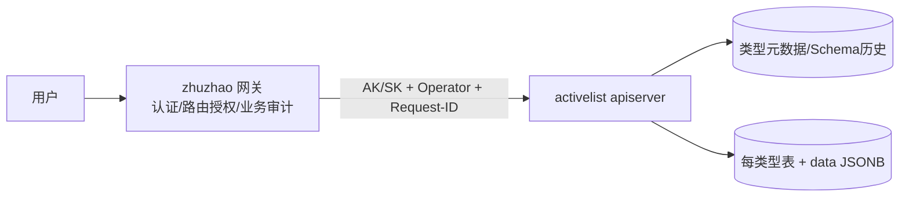

# activelist 当前设计

activelist 是独立服务、独立Go模块、独立PostgreSQL数据库的动态数据模型薄层。一个apiserver承载类型管理、Schema演进、字段校验、数据CRUD和导入导出；不包含原稿的MongoDB、Redis、ChangeStream、事件worker或数据历史快照集合。历史决定见 [ADR-003](../adr/adr-003-integration-contract.md)，原设计在 [归档](../review/archive/activelist-mongodb-design.md)。

## 职责与调用链

服务验证调用方AK/SK，不实现用户角色或行级策略；用户授权在网关。X-Operator入内部签名覆盖，缺失兜底system；X-Request-ID关联请求日志与调用方审计。网络隔离是第二道防线，不能用拓扑替代验签。业务事件由能力属主的操作点发布，业务审计由调用方记录；本服务保留技术访问日志和类型Schema变更历史。

## 当前模型：方案D

类型元数据存当前完整Schema；每类型一张表，动态字段放data JSONB。字段仅int/string/int_list/string_list，无object/date/嵌套/关系/公式。Schema定义version用于并发演进CAS；数据行不带schema_version，读取不迁移，更新在事务中合并旧data和patch后按当前Schema全量校验。破坏性演进允许提交，旧数据下次写入可422并提示迁移；不是演进时全量扫描重写。

`internal/meta/meta.go` 的 `Definition` / `Field` 是准确模型；`internal/service/type_service.go` 的 `TypeService.Register` 将元数据、动态建表和Schema历史同事务提交，`Evolve` 全量替换定义且旧version冲突409。持有事务时查询沿当前tx，不从pool再次借连接，单连接池回归保护该约束。当前无进程内Schema TTL缓存；并发请求已读旧定义后发生演进的时序窗口仍属于现有取舍。

数据version已由迁移000002改成全库持久revision：创建、更新、软删、恢复、导入分配新值，可跳号，客户端不能自行+1。Schema定义version仍是元数据版本，二者不能混用。完整输入、限制及恢复边界见 [数据契约](../api/data-contract.md) 和 [部署升级](../ops/deployment.md)。

## 查询与生命周期

列表按created_at DESC/id DESC复合游标分页，无total、无任意排序/聚合。已实现q跨标量字段关键字搜索、field+value标量精确筛选，以及include_deleted混入软删行。旧“无任何过滤”仅是09月需求基线，不是当前能力。按id单查软删行可见，返回status；类型deprecated不可恢复为active，禁止注册同名/演进/插入/内容更新/导入，但可读、导出以及软删/恢复存量数据。

导出为含软删行的裸JSON数组；导入为单事务锁表、清空含软删行、逐批校验重灌与校准ID序列。它是权威全量替换，不是upsert；业务数据可幂等，revision每次失效。`unique_fields`提供第一档应用查重，不是并发硬唯一约束，见 [数据契约](../api/data-contract.md)。

## 风险边界与未实施项

普通CRUD内存验签上限16MiB；导入单独使用utils流式验签、私有临时文件和配置字节上限，完整验签后才进入导入事务。网关浏览器入口仍1MiB；大导入走授权运维直连，不能把服务1GiB上限当浏览器能力。临时盘、超时、序列备份详见 [运维](../ops/README.md)。

sensitive是已存储的标记，服务日志脱敏没有启用；请求参数可能原样记录并截断，不能声称“不落字段值”。存储加密按原决定暂不做，跨网或合规变化须重新评估。没有metrics路由/事件总线/全量数据历史快照，observability现态为结构化日志与探针；独立浏览器用户面亦未在本仓提供。

## 与 zhuzhao 字典（dict）的边界

本服务承载**业务要处理的清单数据**（量大、可导入导出、软删恢复、字段可演进）；zhuzhao 主仓的**字典（dict，P4-3）**承载**字段可选值的枚举**（code/label 扁平两级、几十项、工单 G2 同库校验与 `lookup_dict` 显示）。二者页面形态相近但职责不同，禁止互相替代（如把枚举迁入本服务、或把清单数据同步进字典做表单选项）。选型判定顺序与细则见 zhuzhao `docs/design/design-decisions.md` §32（2026-11-10 落档）；「从大清单选值」应做引用型字段（远程搜索），数据源走 zhuzhao DataFetcher 的 activelist 源类型。
